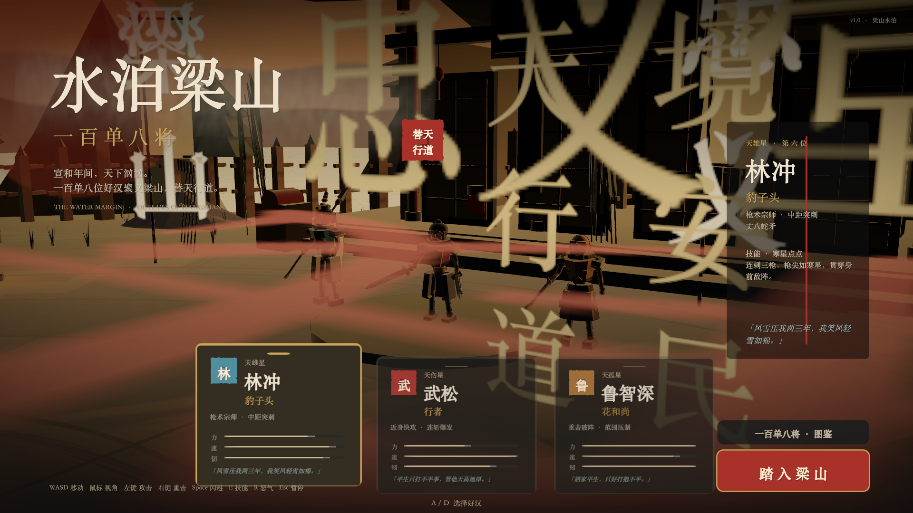
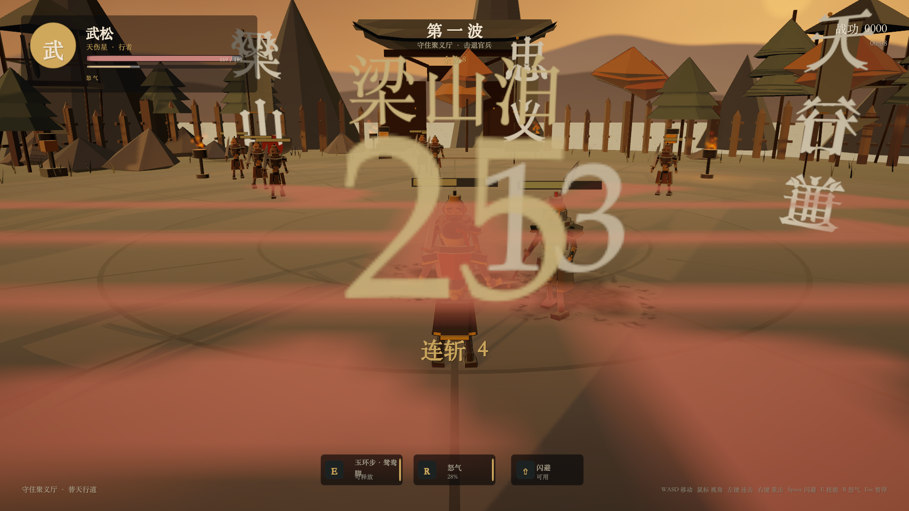
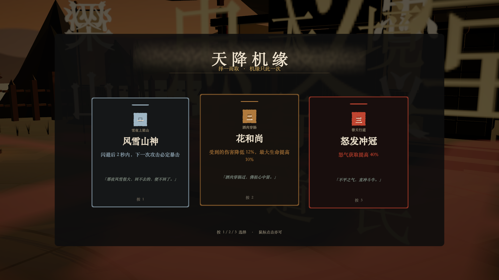
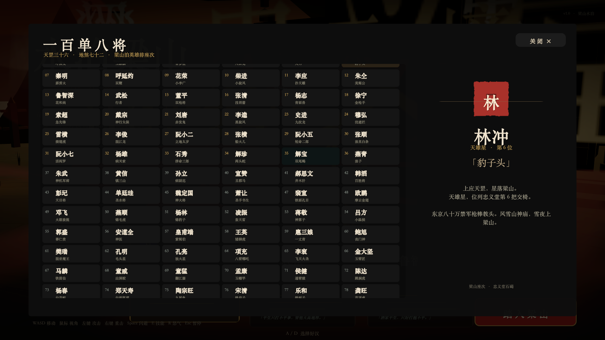
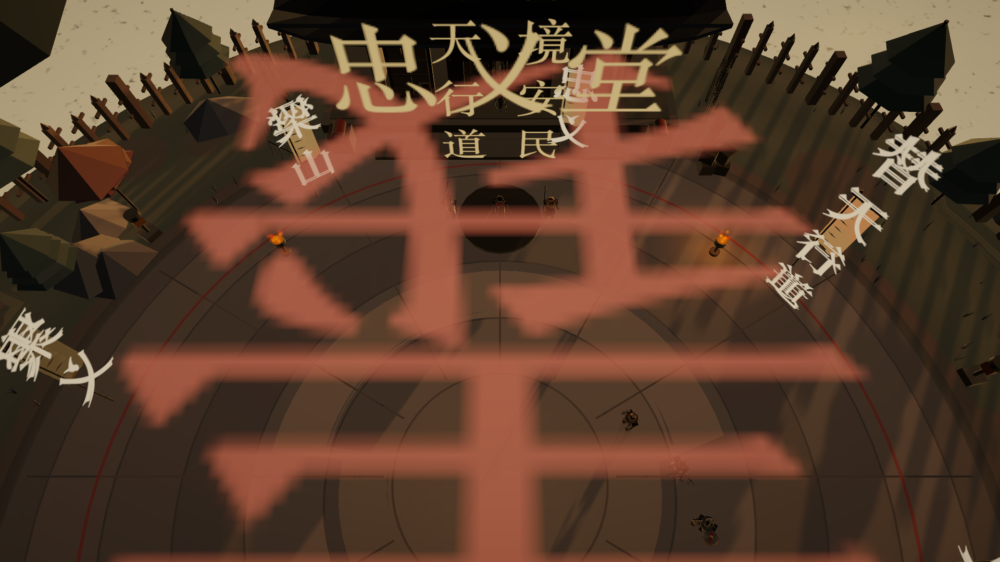

# 一句话，一个娃，一款水浒游戏

## 用 DSH + DeepSeek V4.1，不到 3 小时从空目录做出《水泊梁山 · 一百单八将》

> 小朋友说：“我想玩一个水浒的游戏，能自己选好汉，在梁山上打高俅。”
>
> 我把这句话原样丢进了 DSH（DeepSeek Harness）——一个能读写文件、执行命令、调用工具的 Agent 运行环境。然后我就去等游戏了。
>
> 不到 3 小时，`Build/Liangshan.app` 出现在工程里，双击就能玩。中间隔着 42 个 C# 文件、9,533 行代码和 4 个手写 Shader——但这些都不是我写的。

**不是“AI 辅助我写代码”，是“我把一句话交给它，它把游戏交回来”。** 从需求拆解、写代码、拼 Shader、填 108 将数据，到构建、跑测试、截图自检、修 bug，整个循环都是它自己跑的；我没有中途提需求，也没有盯着改。

**一句话版本：** 一个 3D 第三人称水浒动作游戏，从零到可运行实际投入不到 3 小时。3 名可操作好汉、5 波敌人 + 高俅 Boss、12 种随机机缘、108 将图鉴；Unity 6 + URP，macOS arm64 原生，73 MB；**没有一张外部贴图、一个模型、一段音频、一个动画文件**。下面是技术拆解和踩坑记录。



---

## 一、先看东西

游戏叫《水泊梁山 · 一百单八将》。主菜单是水墨黄昏里的梁山牌楼，三名好汉站在土台上，可以按 `A` / `D` 或 `1` / `2` / `3` 切换。

| | |
| --- | --- |
|  |  |
|  |  |

核心循环是：

```
主菜单 / 选将
    ↓
五波官兵（刀手、枪兵、盾兵、弓手、校尉）
    ↓  每波之间三选一「机缘」
高俅 Boss（第二阶段、召唤援军、范围杀招）
    ↓
胜利 / 失败 → 重开 / 回菜单
```

一局大约 10–15 分钟。三名角色定位不同：

| 好汉 | 生命 | 伤害 | 移速 | 攻击距离 | 连招 | 定位 |
| --- | ---: | ---: | ---: | ---: | ---: | --- |
| 林冲 | 200 | 24 | 6.2 | 3.8 | 4 | 长枪，中距突刺、贯穿 |
| 武松 | 180 | 18 | 6.9 | 2.8 | 5 | 双刀，高速贴身连击 |
| 鲁智深 | 240 | 34 | 5.6 | 3.4 | 3 | 禅杖，重击范围压制 |

每名角色有独立的连招段数、`E` 技能和 `R` 怒气必杀：林冲「寒星点点」/「风雪山神庙」，武松「玉环步·鸳鸯脚」/「血溅鸳鸯楼」，鲁智深「倒拔垂杨柳」/「钱塘潮信」。

敌人的攻击靠三样东西传达意图：**起手动作、地面预警圈、武器颜色**。闪避有 0.3 秒无敌帧，成功闪避后可以立刻接反击；命中会积累怒气，怒气满了才能放必杀。

局外成长只有「机缘」：每波结束从 12 个词条里随机抽 3 个，已选的可以叠加。比如「豹子胆」伤害 +18%、「铁布衫」最大生命 +30%、「风雪山神」闪避后 2 秒内下一击必暴击。

还有一个 108 将图鉴，完整收录座次、星宿、绰号，随时按 `Tab` 查。

---

## 二、一句话是怎么变成游戏的

先说清楚分工：

- **小朋友**：只说了一句话——“想玩水浒，能选好汉，打高俅”。
- **DeepSeek V4.1**：把这句话拆成需求，写 C#、写 Shader、填 108 将数据、修编译错误。
- **DSH**：负责“动手”——读写工程、执行命令、调 Unity 的 batchmode、跑测试、启动构建、截图、把日志拿回来。
- **我**：把这句话原样丢进去，然后等。中间没有提需求、没有看截图、没有喊“这里再改改”。最后只做了一件事：双击，玩。

看起来像“一句话 → 一个游戏”的魔法，中间其实是一个**由 Agent 自己跑完的循环**：

```
说需求 → 搭工程骨架 → 写数据 → 写系统 → 构建 → 跑自动测试 / 截图
   ↑                                                    ↓
   └────────────────── 看结果、改、再跑 ──────────────────┘
```

写、构建、跑、看、改——每一步都是它自己跑的。人只提供了起点（一句话）和终点（试玩）。

真正让它能独立做完的，不是“会写代码”，而是**能自己验证**。Unity 提供了几个关键能力，这个项目全用上了：

- `-batchmode -quit -executeMethod`：命令行构建，不需要人点菜单；
- `-runTests -testPlatform EditMode`：跑 NUnit 数据测试，输出 XML；
- 游戏内埋了 `-autotest` / `-flowtest` / `-uitest` / `-shots` / `-worldpreview`：自动开局、自动跑完五波、自动截菜单/图鉴/机缘/暂停/胜负、从十个机位看场景；
- `-nopost`：关掉后处理，画面出问题时先排除后处理。

没有这些，Agent 只能“写完交差”；有了这些，它才能自己看到“打起来是什么样”。

---

## 三、技术栈

| 项 | 用了什么 |
| --- | --- |
| 引擎 | Unity 6（6000.6.7f1） |
| 渲染 | URP 17.6，Forward，自定义 Toon / Sky / Water / Particle Shader |
| 语言 | C#（42 个文件，9,533 行，含测试与编辑器脚本） |
| UI | UGUI，全部运行时构建，无 Prefab、无 TextMeshPro 字体资产 |
| 输入 | 经典 Input Manager（`activeInputHandler: 0`），不依赖 Input System 包 |
| 音频 | 运行时合成 44.1 kHz 波形，AudioSource 池 |
| 测试 | Unity Test Framework / NUnit，EditMode 6 项 |
| 构建 | `BuildPipeline.BuildPlayer`，macOS Apple Silicon（arm64），73 MB |
| 美术 | 0 外部资源：网格、贴图、Sprite、音效全部代码生成，字体运行时取自系统 |

**代码结构：**

```
Assets/
├── Editor/                 # 命令行构建
├── Resources/Shaders/      # InkToon / InkSky / InkWater / InkParticle
├── Scenes/SampleScene.unity
├── Scripts/
│   ├── Audio/              # 太鼓、铜锣、拨弦、环境声合成
│   ├── Characters/         # 程序化人形骨架、武器、衣摆、受击闪白
│   ├── Combat/             # 玩家、敌人 AI、伤害、弹道、世界血条
│   ├── Core/               # 启动、状态机、运行时资源、网格构建
│   ├── Data/               # 三好汉、敌人、12 机缘、108 将
│   ├── FX/                 # 水墨粒子、刀光、冲击波、伤害数字
│   ├── UI/                 # 菜单、HUD、机缘、暂停、结算、图鉴
│   └── World/              # 梁山演武场、忠义堂、牌楼、山水、灯光
└── Tests/EditMode/         # NUnit 数据测试
```

一个有点反直觉的数字：**场景文件只有 432 行 YAML**，里面基本只有模板自带的 Main Camera、Directional Light 和 Global Volume。游戏不是在编辑器里摆出来的，是运行时从零建出来的。

---

## 四、几个值得写的实现

### 1. 空场景启动，运行时造一个梁山

入口是 `GameBootstrap` 的 `[RuntimeInitializeOnLoadMethod(RuntimeInitializeLoadType.AfterSceneLoad)]`：

1. 先把场景里所有根对象 `Destroy` 掉（清掉模板残留）；
2. `RuntimeAssets.Initialize()` 生成 Shader 材质、贴图、Sprite、字体；
3. `WorldBuilder.Build()` 搭岛、山、水面、忠义堂、牌楼、演武场、松树、火盆、旗帜；
4. 建相机、初始化输入；
5. `Game.Initialize()` 进状态机。

世界参数集中在 `GameConfig`：岛半径 33、水面高度 -7.8、竞技场半径 21.5、玩家活动边界 25.5、忠义堂在 z=27.5。

这样做的好处是**零 Prefab 依赖**，克隆下来打开就能跑；代价是所有初始化顺序都得自己管——`RuntimeAssets` 必须早于 `WorldBuilder`，材质和 Sprite 必须按 key 缓存，否则同一个颜色会生成一堆材质，draw call 直接起飞。

### 2. 零素材的美术管线

所有东西都是算出来的：

- **贴图**：圆角矩形、圆形、菱形、笔刷、印章、纸纹、暗角、墨点，全是 `SetPixels32` + `SmoothStep` / `PerlinNoise` 生成；
- **网格**：`MeshBuilder` 负责低多边形山体、悬崖、带翘角的屋顶、旗子、栏杆、武器；`WorldBuilder` 负责把它们摆成一座岛；
- **颜色**：全局只有一套很窄的色板——宣纸米白、朱砂红、鎏金、墨黑、青灰；地形大量使用顶点色；
- **Shader**：`InkToon` 做三段式明暗 ramp、暖色 rim、反向外扩描边；`InkSky` 做渐变天空、云层、远山；`InkWater` 做波纹、岸边泡沫、天色反射；`InkParticle` 做水墨粒子。

`InkToon` 不是一个只写 `ForwardLit` 的玩具 Shader。它包含四个 Pass：

```hlsl
Pass { Name "ForwardLit"  Tags { "LightMode"="UniversalForward" } }
Pass { Name "Outline" }
Pass { Name "ShadowCaster" }
Pass { Name "DepthOnly" }
```

并且带 `_MAIN_LIGHT_SHADOWS`、`_SHADOWS_SOFT`、`_ADDITIONAL_LIGHTS`、雾、GPU instancing 的 keyword。

### 3. 没有 Animator，角色怎么动

项目里没有 `.anim`、没有 `.controller`、没有骨骼模型。角色是 `CharacterFactory` 用基本体拼出来的，`ProceduralRig` 负责让它动：骨盆、胸腔、护肩、脖子、手臂、腿、衣摆，每把武器单独挂接。

动画也不是 Clip，而是**代码里的姿势**：每个关节存一个相对 bind pose 的欧拉角，`PlayAttack(index, duration)` 在时间内插到目标姿势；待机有呼吸起伏，攻击有快速切入再保持，受击有闪白，衣摆有顶点飘动，刀光是程序化生成的弧形网格。

这带来的好处是角色完全自包含、可以按体型/武器/颜色批量生成；坏处是“动作好不好看”全靠手调参数，而且没有 root motion，位移得在代码里补。

### 4. 手感是调出来的，不是写出来的

几个关键点：

- **自动锁定**：不是硬锁，而是按 `距离 + 角度 × 0.09` 打分，选最近的敌人；攻击是面向方向的扇形判定，不会“隔山打牛”；
- **连招**：左键连点推进段数，每段有独立的前摇、命中窗口、后摇和位移；超时或停手会重置；
- **闪避**：0.3 秒位移 + 无敌帧 + 残影 + 风声，冷却受「神行太保」影响；
- **顿帧**：命中瞬间把 `Time.timeScale` 压到 0.055（几乎停住），按轻重持续 0.035–0.07 秒，再弹回 1；
- **预警**：敌人起手时在地面画圈，Boss 的范围杀招有更大的圈和更长的预警；
- **镜头**：第三人称跟随 + Perlin 噪声震屏 + 菜单运镜 + 胜负慢镜头。

这些参数没有一个是“默认就对”的。Agent 能写出来，也能靠自动截图、战斗日志和测试把明显的错修掉；但“打上去爽不爽”，最终还是要人来玩——只不过这时候人做的已经是试玩，不是开发。

### 5. 声音也是算出来的

`AudioDirector` 在启动时合成所有音频：太鼓、轻鼓、铜锣、刀风、命中、受伤、琵琶拨弦、箭矢、选择音、胜利/失败音型，外加一层环境风声。

全部是 `AudioClip.Create` + 采样数据：正弦谐波、噪声、包络，44.1 kHz。运行时有 14 个 AudioSource 组成池子，按距离衰减，避免每次播放都 `Instantiate`。

### 6. 108 将和运行时 UI

UI 没有 Prefab，全部由 `UIKit` 在运行时搭：`CanvasScaler` 1920×1080、`matchWidthOrHeight = 0.5`，宽屏不会把布局拉飞。

图鉴是最重的一块：108 个格子一次性生成，`GridLayoutGroup` 固定 6 列，`ContentSizeFitter` 撑高度，`RectMask2D` + `ScrollRect` 裁剪滚动；右侧详情面板显示座次、星宿、绰号和小传。字体是运行时从系统字体里挑的（下一节细说）。

### 7. 数据与测试

数据全部是纯 C#：`HeroDatabase`（3 名可玩好汉）、`EnemyDefinition`（刀手/枪兵/盾兵/弓手/校尉/高俅）、`BoonDefinition`（12 条机缘）、`Heroes108`（108 将）。

EditMode 测试 6 项，全部通过：

1. 图鉴正好 108 人，座次 1–108 各出现一次；
2. 每个人的名字、绰号、星宿都不为空，星宿含“星”；
3. 三名可玩好汉的 ID 不重复，生命/伤害/连招/技能名合法；
4. 抽 42 次机缘，每次 3 条且不重复，且都能正确应用到属性上；
5. 竞技场半径 < 岛半径，玩家边界 < 岛半径，出生点在岛内，总波次为 5；
6. 色板能把 `B84132` 解析成正确的 `Color32`。

这些测试不测“好不好玩”，但能挡住“108 将少一个”“抽卡抽出重复”这种最容易在演示时翻车的错误。

---

## 五、踩过的坑

### 坑 1：中文字体，Unity 内置字体根本不够用

**症状**：UI 里全是方框，或者只有英文正常。

**原因**：Unity 内置的 `LegacyRuntime.ttf` 几乎不含汉字；TextMeshPro 又要预生成字体图集，构建时容易缺字；而项目不想背一个几十 MB 的中文字体文件。

**解法**：启动时枚举系统字体，按优先级动态创建：

```csharp
string[] installed = Font.GetOSInstalledFontNames();
TitleFont  = CreateFont(installed, new[] { "Songti SC", "STSong", "Songti TC",
                                           "Hiragino Mincho ProN", "Hiragino Sans GB" }, 72);
BodyFont   = CreateFont(installed, new[] { "Songti SC", "STSong",
                                           "Hiragino Sans GB", "Arial Unicode MS" }, 48);
NumberFont = CreateFont(installed, new[] { "Palatino", "Optima", "Times New Roman" }, 48);
```

每个字体都有 fallback 链，找不到就换下一个，最后兜底到内置字体。`Font.CreateDynamicFontFromOSFont` 还会吞异常，所以每一步都包了 `try/catch`。

**代价**：它绑死了 macOS 系统字体（宋体/苹方），浏览器拿不到 OS 字体，所以这个项目**没有 WebGL 版**。这是明确写进 README 的限制，不是忘了做。

### 坑 2：URP 自定义 Shader 的“隐藏契约”

**症状**：模型不投影、阴影里没有它，或者依赖深度的后处理边缘穿帮。

**原因**：URP 不是“写个 ForwardLit 就能跑”。不写 `ShadowCaster`，物体不会投阴影；不写 `DepthOnly`，依赖深度的效果会穿帮；还要处理 shadow keyword、additional lights、fog、instancing。

**解法**：`InkToon` 补齐四个 Pass，按 URP 的 LightMode 打标签，keyword 用 `multi_compile` 声明。材质的 `enableInstancing = true`，同色同描边宽度的材质走缓存。

另一个相关的坑是**景深**：编辑器里看着正常，玩家构建时 URP 把 DOF 的 Shader 变体剥掉了，控制台会出相关 warning。最后的处理很直接：不跟 stripping 硬碰，砍掉景深，用 `Bloom + Tonemapping(Neutral) + ColorAdjustments + WhiteBalance + Vignette + FilmGrain` 把画面撑住；另外留了 `-nopost` 参数，出画面问题先关后处理定位。README 的“已知限制”里也留了这一条。

还有一个兜底：`RuntimeAssets.LoadShader` 如果 `Resources.Load` 不到自定义 Shader，会退回 URP Lit / Skybox / Unlit / Sprites Default，不至于直接黑屏。

### 坑 3：输入系统选型，别给自己加戏

**症状**：编辑器里能走，构建后人物不动；或者项目里同时存在新旧两套输入。

**原因**：Unity 6 新项目容易默认往 Input System 走，而代码用的是 `Input.GetAxis` / `Input.GetMouseButton`。两套混用，Player 里行为不一定一致。

**解法**：一开始就定死用经典 Input Manager，`activeInputHandler: 0`，不装 Input System 包。`InputReader` 是一个纯静态类，所有按键集中在一处，后续要改键位或加手柄也有单一入口。

**代价**：没有手柄、没有按键重绑定。这也是已知限制。

### 坑 4：空场景启动，最怕“初始化顺序”和“残留对象”

**症状**：进 Play 后出现两个相机、两个世界，或者材质变成粉色。

**原因**：模板场景自带 Main Camera、Directional Light、Global Volume；`GameBootstrap` 又建一套。另外 `RuntimeAssets` 如果晚于 `WorldBuilder`，Shader/材质还没准备好。

**解法**：

- `Boot()` 第一件事是遍历 `scene.GetRootGameObjects()` 全部 `Destroy`；
- `RuntimeAssets.Initialize()` 用 `_initialized` 保证只跑一次；
- 材质按 `颜色 + 阴影色 + 描边宽度 + 顶点色 + 双面` 拼 key 缓存，Sprite 也缓存；
- 场景里只保留一个空壳，所有对象都挂在 `Liangshan 108` 根节点下，方便整体清理。

### 坑 5：没有素材，就必须接受“风格化”

**症状**：想做写实水浒，但既没有模型也没有贴图，硬做就是灾难。

**解法**：反过来，把限制变成风格——**水墨 + 低多边形**。硬边色块、墨线描边、纸张颗粒、宣纸色板；角色用基本体拼，场景用低模和顶点色；镜头用暖色黄昏 + 冷色天光 + 雾 + 暗角压住细节。

**代价**：美术上限就在那里，近看经不起推敲。但对“小朋友能玩、能看懂、有辨识度”这个目标，它是够的，而且风格统一。

### 坑 6：Agent 没有手感，只能把游戏做成“可观测”的

这是我觉得最值得分享的一条。

Agent 能写代码，但它没法“玩”游戏。它不知道打击感对不对、镜头晕不晕、Boss 是不是太肉。所以它给自己造了一套“验收”工具，把“看结果”变成可执行的命令：

- `-autotest`：自动开局，攻击、闪避、放技能，输出战斗状态；
- `-flowtest`：自动跑完五波、机缘、Boss，逐波截图；
- `-uitest`：依次截机缘、暂停、胜利、失败界面；
- `-shots`：截菜单、图鉴、战斗、技能；
- `-worldpreview -shotdir`：十个机位看场景；
- `-nopost`：关后处理排查画面；
- `-chartest`：单独看角色转台。

再加上 6 个 EditMode 数据测试，Agent 每次改完都能自己回答三个问题：**能编译吗？能跑通吗？画面/数据对吗？**

没有这套东西，“AI 做游戏”就会停在“代码看起来写完了”这一步。

---

## 六、现在的限制

说清楚它不是什么：

- **只有 macOS（Apple Silicon / arm64）构建**，73 MB；没有 Windows、没有 WebGL。原因之一就是上面说的系统字体依赖。
- **没有手柄、没有按键重绑定**；暂停菜单只有鼠标灵敏度。
- **程序化低模 + 代码动画**，没有写实模型、没有骨骼动画、没有面部表情。
- **内容量是垂直切片**：一张地图、三好汉、五波敌人、一个 Boss、12 条机缘。没有剧情演出、没有装备树、没有多周目。
- **平衡是手调的**，没有经过大量玩家验证；高俅二阶段的难度曲线尤其主观。
- 画面里的景深方案被 URP 的 Shader stripping 挡掉，最终版本没有景深，构建日志里可能还有相关 warning，不影响运行。

---

## 七、最后

做之前，我对“AI 做游戏”的想象是“一句话生成一个能玩的东西”。做完之后，这个想象基本成立，只是过程比我想的安静：没有结对编程，没有一轮轮改需求，把话丢进去，然后等。

**AI 把“实现”这一段整个吞掉了，“定义”和“验收”还在，但人只需要出现在两头。**

以前卡住一个想法的是：不会 Unity、不会 C#、不会建模、不会做 UI、不会打包。现在这些都可以被跨过去，真正剩下的只有两件事：

- **起点：一句话得具体到能落地。**“做个水浒游戏”太虚；“能选好汉、上梁山打高俅”已经够它跑起来。剩下的 3 名好汉、5 波敌人、12 条机缘、一个二阶段 Boss，是它在这句话的边界内自己补的。
- **终点：最后得有人玩一遍。**数值、手感、镜头、节奏，Agent 判断不了；但这时候人做的已经是“试玩”，不是“开发”。

小朋友贡献的是想象力和最朴素的需求；模型贡献的是工程能力；DSH 贡献的是“能动手”——读写文件、跑 Unity、看日志、截图。三者缺一不可。我做的事只有一件：把话带过去，然后在门口等。

它当然离“好游戏”还很远。但它是一个完整的闭环：主菜单、选将、战斗、成长、Boss、胜负、重开，双击就能玩。对一个小朋友来说，“一句话变成了一个真的游戏”，这件事本身可能比游戏好不好玩更重要。

---

## 附：运行与构建

直接运行（macOS）：

```bash
open Build/Liangshan.app
```

在 Unity 中打开：Unity 6（6000.6.7f1），打开 `Assets/Scenes/SampleScene.unity`，Play。

命令行构建：

```bash
UPM_CACHE_ROOT="$PWD/.upm-cache" \
/Applications/Unity/Hub/Editor/6000.6.7f1/Unity.app/Contents/MacOS/Unity \
  -batchmode -quit -projectPath "$PWD" \
  -executeMethod Liangshan.EditorTools.BuildTools.BuildMacRelease \
  -logFile /tmp/liangshan-build.log
```

跑测试：

```bash
UPM_CACHE_ROOT="$PWD/.upm-cache" \
/Applications/Unity/Hub/Editor/6000.6.7f1/Unity.app/Contents/MacOS/Unity \
  -batchmode -runTests -projectPath "$PWD" \
  -testPlatform EditMode -testResults /tmp/liangshan-tests.xml \
  -logFile /tmp/liangshan-tests.log
```

两条命令都带 `UPM_CACHE_ROOT="$PWD/.upm-cache"`：把 Unity 包缓存固定在项目内，批量跑构建/测试时环境更可控，也不去动全局缓存。

自动跑全流程并截图：

```bash
"./Build/Liangshan.app/Contents/MacOS/Liangshan 108" \
  -screen-width 1920 -screen-height 1080 -screen-fullscreen 0 \
  -flowtest -flowdir /tmp/liangshan-flow
```

---

### 短版（适合发即刻 / 朋友圈 / X）

> 小朋友一句话说想玩水浒：能选好汉，在梁山上打高俅。我把这句话原样丢给 DSH + DeepSeek V4.1，然后就去等游戏了。不到 3 小时，一个 73 MB 的 macOS 游戏可以双击运行：3 名好汉、5 波敌人、高俅 Boss、12 种机缘、108 将图鉴，水墨黄昏、全程序化美术、零外部素材，42 个 C# 文件 9,533 行，6/6 测试通过。
>
> 最大的感受不是“AI 会写游戏”，而是“实现”被整个吞掉后，人只需要出现在两头：开头把话说具体，最后双击玩一遍。中间那 3 小时，不需要人。

---

*标签：#Unity #URP #AI编程 #DeepSeek #游戏开发 #独立游戏 #水浒传*
