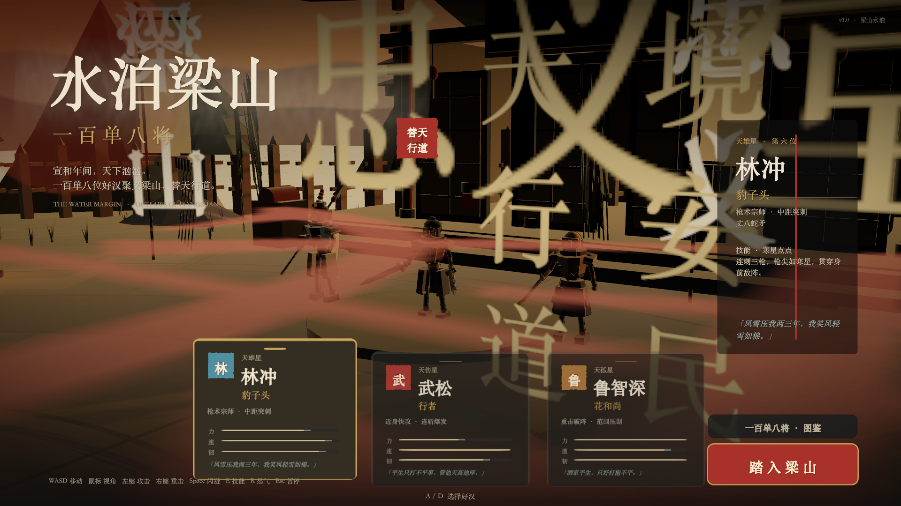
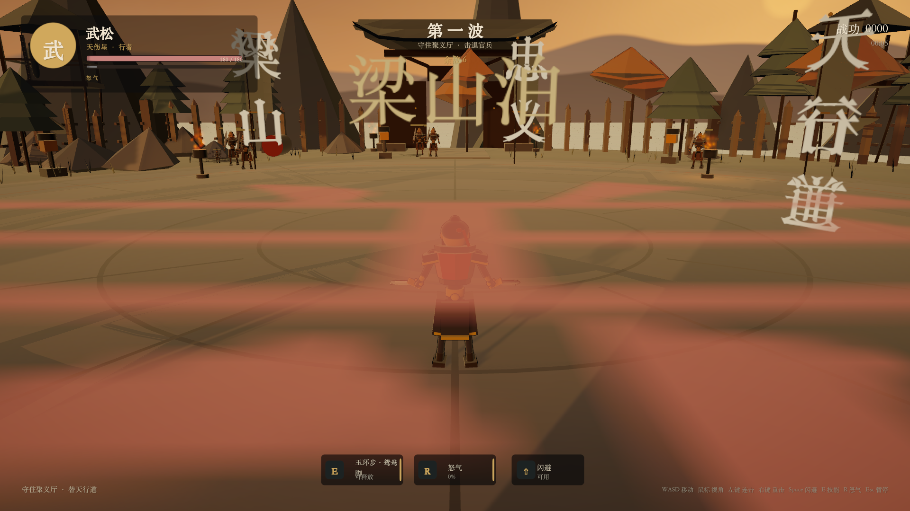
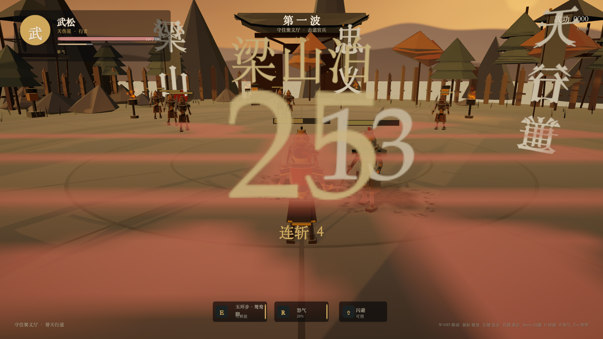
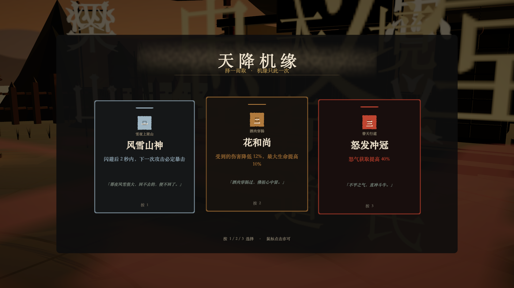
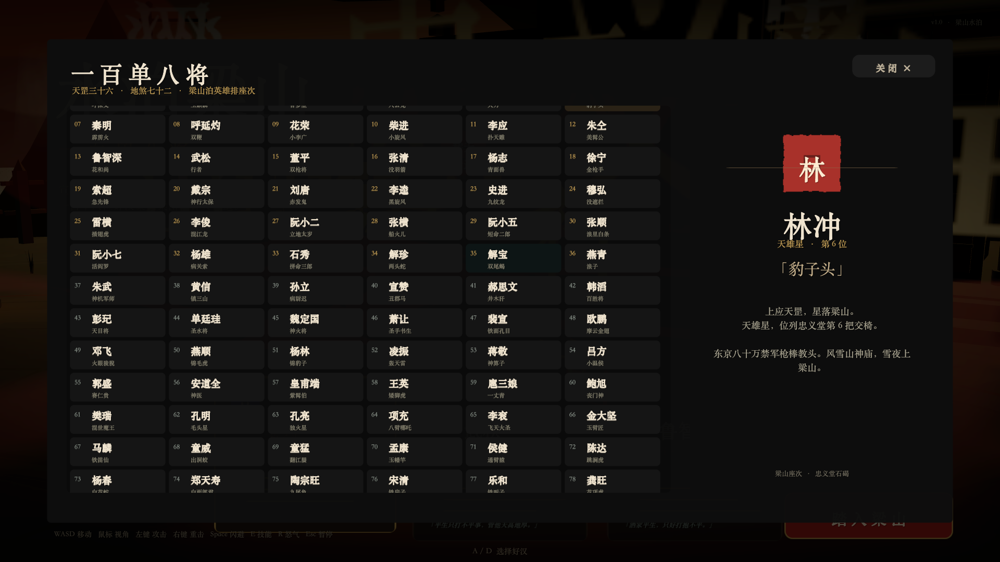
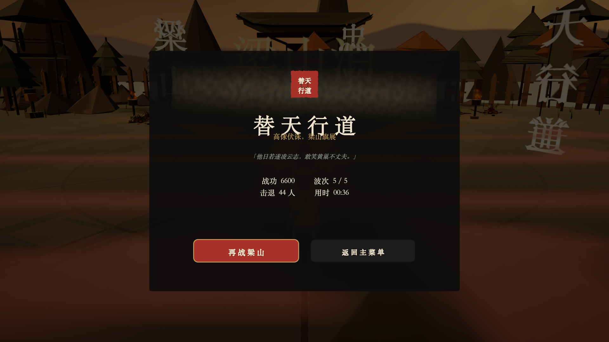
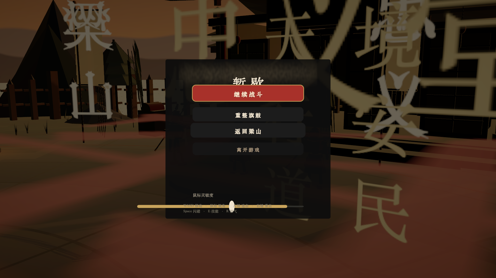
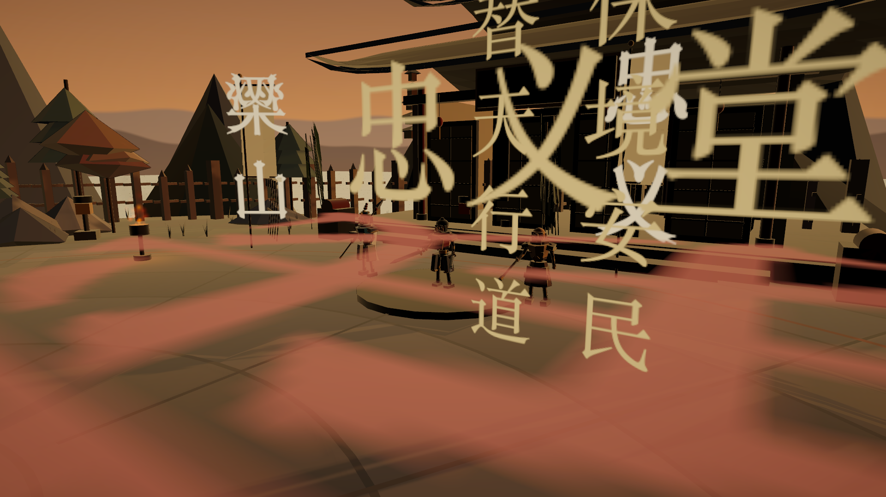
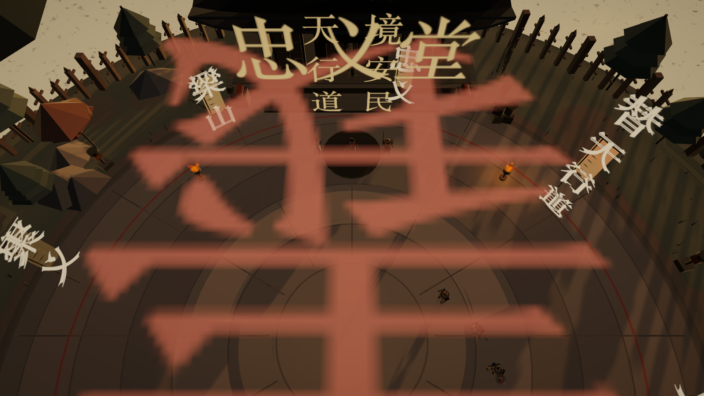

# 水泊梁山 · 一百单八将

一款以《水浒传》梁山泊为背景的 **3D 第三人称动作游戏**，使用 **Unity 6 / URP** 制作。玩家可从林冲、武松、鲁智深三位好汉中择一出战，在忠义堂前的演武场上击退五波官兵，最终迎战高俅。



## 游戏特色

- **三名可操作好汉**：林冲（长枪 · 中距突刺）、武松（双刀 · 高速连击）、鲁智深（禅杖 · 重击破阵）。每名角色拥有独立的连招段数、攻击范围、技能与怒气必杀。
- **五波敌潮 + 高俅 Boss**：刀手、枪兵、盾兵、弓手、校尉依次登场；高俅拥有第二阶段、召唤援军与范围杀招。
- **天降机缘**：每波结束三选一，12 种词条涵盖伤害、生命、吸血、暴击、闪避、连招、范围与怒气循环。
- **一百单八将图鉴**：完整 108 将星宿、绰号与座次，可随时查阅。
- **水墨黄昏美术**：所有场景、角色、道具、UI 纹理均在运行时程序化生成；自定义 URP Toon / 天空 / 水面 / 粒子 Shader，无任何外部美术资源。
- **程序化音效**：太鼓、铜锣、刀风、命中、受击、琵琶拨弦与环境声均由代码合成。
- **完整流程**：主菜单 → 选将 → 战斗 → 机缘 → Boss → 胜利 / 失败 → 重开或返回菜单；支持暂停、鼠标灵敏度调节。



## 操作

| 操作 | 按键 |
| --- | --- |
| 移动 | `W` `A` `S` `D` |
| 视角 | 鼠标移动 |
| 连击 | 鼠标左键 |
| 重击 | 鼠标右键 |
| 闪避 | `Space`（或 `Left Shift`） |
| 技能 | `E` |
| 怒气必杀 | `R` |
| 暂停 | `Esc` |
| 菜单选将 | `A` / `D`、`1` / `2` / `3` |
| 菜单开始 | `Enter` / `Space` / 点击按钮 |
| 图鉴 | `Tab` |

战斗中自动锁定最近的敌人，攻击会朝面向方向扇形判定；闪避期间无敌，成功后可在短时间内接续反击。命中会积累怒气，怒气条满后按 `R` 释放必杀。



## 运行

### 直接运行（macOS，本地已有构建）

```bash
open Build/Liangshan.app
```

系统要求：macOS 13+，Apple Silicon（当前构建为 arm64）。首次启动会稍慢，因为所有纹理与网格都在运行时生成。

> 为控制仓库体积，`Build/` 已在 `.gitignore` 中忽略。GitHub 仓库不包含 72 MB 的预构建 app；从仓库克隆后，请用下方 Unity 步骤在本地构建，或从 Releases 获取构建包。

### 在 Unity 中打开

```bash
git clone git@github.com:blackstar-baba/108-game.git
```

1. 使用 **Unity 6（6000.6.7f1）** 或兼容的 Unity 6 版本打开项目根目录。
2. 打开 `Assets/Scenes/SampleScene.unity`。
3. 进入 Play Mode。游戏会从主菜单开始。

项目使用 **Built-in Input Manager**（`activeInputHandler: 0`），不需要安装 Input System。

### 重新构建

Unity 菜单：`Liangshan → Build macOS`，产物为 `Build/Liangshan.app`。

命令行构建：

```bash
UPM_CACHE_ROOT="$PWD/.upm-cache" \
/Applications/Unity/Hub/Editor/6000.6.7f1/Unity.app/Contents/MacOS/Unity \
  -batchmode -quit -projectPath "$PWD" \
  -executeMethod Liangshan.EditorTools.BuildTools.BuildMacRelease \
  -logFile /tmp/liangshan-build.log
```

## 测试

项目包含 EditMode 数据测试，覆盖 108 将完整性、可玩角色配置、机缘随机不重复、竞技场常量与色板解析：

```bash
UPM_CACHE_ROOT="$PWD/.upm-cache" \
/Applications/Unity/Hub/Editor/6000.6.7f1/Unity.app/Contents/MacOS/Unity \
  -batchmode -runTests -projectPath "$PWD" \
  -testPlatform EditMode -testResults /tmp/liangshan-tests.xml \
  -logFile /tmp/liangshan-tests.log
```

结果：**6 / 6 passed**。

游戏还提供若干仅用于开发验收的启动参数：

| 参数 | 作用 |
| --- | --- |
| `-autotest` | 自动开始一局，攻击、闪避、放技能并输出战斗状态 |
| `-flowtest` | 自动跑完五波、机缘与 Boss，截取全流程画面 |
| `-uitest` | 依次截取机缘、暂停、胜利、失败界面 |
| `-shots <dir>` | 截取菜单、图鉴、战斗、技能画面 |
| `-worldpreview -shotdir <dir>` | 从十个机位截取场景 |
| `-nopost` | 关闭后处理，便于排查画面 |

例如：

```bash
"./Build/Liangshan.app/Contents/MacOS/Liangshan 108" \
  -screen-width 1920 -screen-height 1080 -screen-fullscreen 0 \
  -flowtest -flowdir /tmp/liangshan-flow
```

## 画面

| | |
| --- | --- |
|  |  |
|  |  |
|  |  |

## 技术结构

```
Assets/
├── Editor/                 # 构建与编译检查
├── Resources/Shaders/      # InkToon / InkSky / InkWater / InkParticle
├── Scenes/SampleScene.unity
├── Scripts/
│   ├── Audio/              # 程序化太鼓、铜锣、拨弦与环境声
│   ├── Characters/         # 程序化人形骨架、武器、衣摆、受击闪白
│   ├── Combat/             # 玩家、敌人 AI、伤害、弹道、世界血条
│   ├── Core/               # 启动、游戏状态机、运行时资源、网格构建
│   ├── Data/               # 三好汉、敌人、12 机缘、108 将
│   ├── FX/                 # 水墨粒子、刀光、冲击波、伤害数字
│   ├── UI/                 # 菜单、HUD、机缘、暂停、结算、图鉴
│   └── World/              # 梁山演武场、忠义堂、牌楼、山水、灯光
└── Tests/EditMode/         # NUnit 数据测试
```

**核心设计**

- `GameBootstrap` 在空场景中创建全部运行时对象，不依赖预制体或美术资源。
- `RuntimeAssets` 统一生成 Shader 材质、圆角/印章/笔刷/噪声纹理、字体与缓存。
- `MeshBuilder` + `WorldBuilder` 用低多边形与顶点色搭建岛屿、山体、建筑、旗帜与水面。
- 角色由 `ProceduralRig` 以基本体拼装，攻击动作由代码驱动，避免 Animator 与外部动画文件。
- `Game` 状态机负责菜单、战斗、机缘、暂停、胜负与重开；`CameraDirector` 负责第三人称跟随、菜单运镜与震屏。
- UI 全部由 `UIKit` 在运行时构建，支持 16:9 与常见宽屏比例。

## 设计文档

更完整的系统数值、波次表、场景布局与美术方向见 [Docs/GAME_DESIGN.md](Docs/GAME_DESIGN.md)。

## 已知限制

- 当前为单人垂直切片；角色与敌人为程序化低模，没有外部写实模型或骨骼动画。
- 仅提供 macOS（Apple Silicon / arm64）构建；UI 依赖 macOS 系统中文字体（宋体 / 苹方回退），因此没有发布 WebGL 版本。
- 没有手柄与按键重绑定；暂停菜单仅提供鼠标灵敏度调节。
- 画面中的后处理景深 Shader 在构建时被 URP 剥离，控制台可能出现相关警告，不影响运行。

---

**梁山水泊，替天行道。**
